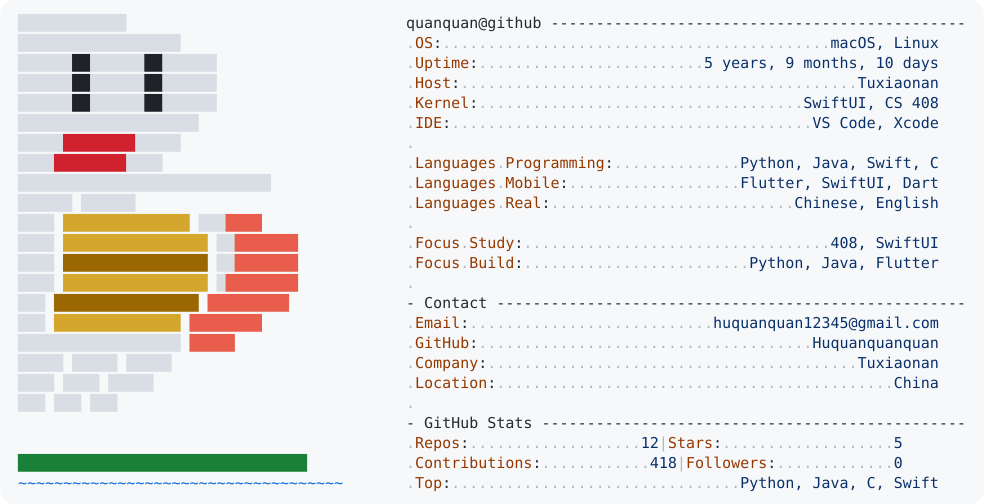

<a href="https://github.com/Huquanquanquan">
  <picture>
    <source media="(prefers-color-scheme: dark)" srcset="./dark_mode.svg">
    <source media="(prefers-color-scheme: light)" srcset="./light_mode.svg">
    
  </picture>
</a>

  
**摸鱼日历📅**

<picture>
  <source media="(prefers-color-scheme: dark)" srcset="https://raw.githubusercontent.com/Huquanquanquan/Huquanquanquan/output/pacman-contribution-graph-dark.svg">
  <source media="(prefers-color-scheme: light)" srcset="https://raw.githubusercontent.com/Huquanquanquan/Huquanquanquan/output/pacman-contribution-graph.svg">
  
</picture>
